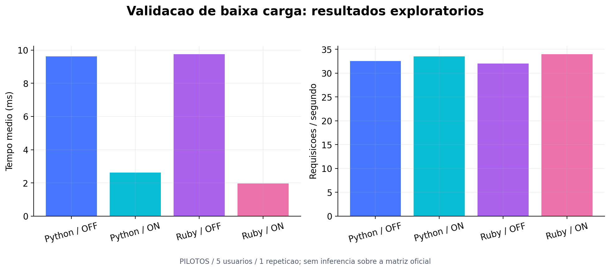

# Relatório dos pilotos e ponto de aprovação

Data: 29/10/2026. Fases 1, 2 e 3 concluídas. Fase 4: aguardando aprovação explícita.

**Não houve execução oficial.** O conjunto abaixo é exploratório: 5 usuários, 5 s de rampa, 20 s de medição, 1 repetição por cenário. A barreira separa a rampa e a drenagem completa as sequências iniciadas. Espera entre sequências: 1 a 2 s.

## Resultados reais dos pilotos válidos

| Cenário | API | Cache | Chamadas | Sequências | Falhas | Média (ms) | Mediana (ms) | P95 (ms) | P99 (ms) | RPS | Janela real (s) |
|---|---|---|---:|---:|---:|---:|---:|---:|---:|---:|---:|
| A | python | OFF | 650 | 65 | 0 | 9.62 | 6 | 22 | 79 | 32.50 | 20.000 |
| B | python | ON | 670 | 67 | 0 | 2.62 | 2 | 5 | 7 | 33.50 | 20.000 |
| C | ruby | OFF | 640 | 64 | 0 | 9.76 | 8 | 19 | 66 | 32.00 | 20.000 |
| D | ruby | ON | 680 | 68 | 0 | 1.97 | 2 | 4 | 5 | 34.00 | 20.000 |

## Recursos e suficiência das sequências

| Cenário | CPU média API (% de 1 núcleo) | CPU pico API (%) | Pico RAM API (MiB) | CPU média Locust (%) | Pico CPU Locust (%) | P95 atraso event loop (ms) | Mín. RAM livre host (MiB) | Menor nº sequências por usuário |
|---|---:|---:|---:|---:|---:|---:|---:|---:|
| A | 16.51 | 34.82 | 99.47 | 4.63 | 8.00 | 7.39 | 504.70 | 12 |
| B | 12.84 | 47.98 | 96.01 | 5.25 | 10.90 | 9.11 | 400.57 | 12 |
| C | 14.64 | 28.06 | 124.90 | 5.78 | 13.90 | 9.02 | 417.15 | 11 |
| D | 5.53 | 20.31 | 85.51 | 4.85 | 8.00 | 6.28 | 2460.06 | 12 |

## Verificações aprovadas

- Compose válido, imagens construídas e serviços inicializados. Versões de runtime e limites registrados em `ambiente/`.
- Dez páginas acessíveis com HTTP 200, tamanho exato e SHA-256 corretos. Python e Ruby produziram a lista ordenada completa esperada em todas as páginas.
- OFF: zero GET, SET, hits e misses adicionais no Redis durante a validação e a carga. A extração continua com HTTP 200 quando o Redis deste projeto é parado.
- ON: dez MISS seguidos de dez HIT na preparação; dez chaves verificadas. Com Redis parado, a API responde 503. Redis é restaurado e as dez URLs são reaquecidas antes da medição.
- ON durante a carga: apenas HIT, nenhum SET ou miss; cada chamada registra o cabeçalho de cache no CSV.
- Cada sequência medida contém exatamente dez chamadas e as dez URLs distintas, verificadas por agrupamento independente de usuário e sequência no CSV bruto.
- Contagens, falhas, média, bytes de resposta e percentis conferem com o snapshot final nativo do Locust. Não houve reinícios ou OOM das APIs.
- Os 36 arquivos originais de step0 a step6 permanecem com os mesmos hashes. Outros projetos e contêineres não foram alterados.

## O que os resultados permitem dizer

Fato: as quatro configurações funcionaram nessa carga pequena, com as latências e vazões mostradas na tabela. Cache aquecido evitou a busca e o parsing das páginas. A carga inclui espera entre sequências; isso limita o crescimento do RPS mesmo quando a latência cai bastante.

Inferência a investigar: diferenças entre BeautifulSoup/Requests/Gunicorn e Nokogiri/Net::HTTP/Puma podem contribuir para as diferenças. Esses pilotos não isolam a linguagem e não demonstram capacidade máxima. Uma repetição por cenário não fornece desvio-padrão entre repetições nem permite generalizar para 50/100 usuários.

## Anomalias diagnosticadas e preservadas

O primeiro piloto Python/OFF tinha 570 amostras finais na memória, mas o CSV periódico parou em 554. A execução foi excluída. A correção produz `locust_final_stats.csv` pelo serializador nativo do Locust, preservando o CSV periódico original.

Na primeira validação Ruby, o endpoint query extraiu corretamente as dez páginas, mas o endpoint legado retornou 400 porque o Sinatra normalizou barras repetidas. A API foi corrigida para ler a URI original; as validações seguintes passaram.

A auditoria posterior identificou ausência do campo de cache no CSV individual: o HttpSession copia o contexto enviado. O cabeçalho já era validado online e os contadores Redis estavam corretos, mas as quatro tentativas foram excluídas da consolidação comparativa e repetidas com o registro corrigido. Os resumos anteriores e todos os arquivos brutos foram preservados. O consolidado identifica cada tentativa excluída e sua justificativa.

## Campanha proposta para aprovação

- 36 execuções sequenciais: Python/Ruby x OFF/ON aquecido x 10/50/100 usuários x 3 repetições.
- Rampa de 30 s, medição de 120 s, espera de 1 a 2 s por sequência e recuperação de 10 s, iguais nos quatro cenários.
- Ordem aleatória em blocos por repetição, semente 20261029; plano completo em `../configuracoes/campanha-planejada.csv`.
- Tempo mínimo nominal de rampa + medição + recuperação: 96 minutos; com preparação e verificações, estimativa de aproximadamente 2 horas, podendo se aproximar de 2h15.
- Os níveis de 50/100 usuários ainda não foram testados. A campanha interrompe para inspeção se houver saturação do gerador, perda de cache aquecido, reinício/OOM, sequências incompletas, duração anormal ou taxa de falhas maior que 5%.

## Riscos e limites do ambiente

O notebook compartilha CPU e memória entre gerador, serviços, Windows/WSL e aplicações externas. Dois contêineres externos permanecem ativos. A RAM livre observada está na tabela; consumo de memória, energia e aquecimento podem variar ao longo de duas horas. Há encerramento controlado se a RAM disponível ficar abaixo de 384 MiB em três coletas consecutivas. Cotas não reservam núcleos físicos exclusivos. A ausência de saturação em cinco usuários não garante ausência em 100.

## Arquivos para revisão

- `../docker-compose.yml`, `../locust/locustfile.py` e `../scripts/experimento.py`: implementação e execução.
- `METODOLOGIA.md`, `AUDITORIA.md`, `auditoria-resultados-pilotos.json`: método e evidências.
- `../resultados/pilotos/consolidado/execucoes.csv`: todas as tentativas com identificação de validade.
- `../resultados/pilotos/consolidado/agregados.csv`: somente os quatro pilotos válidos, n=1.
- `../resultados/pilotos/consolidado/rastreabilidade-sha256.csv`: caminhos e hashes dos arquivos brutos.

## Pendências deliberadas no ponto de aprovação

Campanha oficial, consolidação de 36 execuções, gráficos oficiais, análise com três repetições, PDF de defesa e apresentação PPTX para Google Slides ainda não foram produzidos. Esses entregáveis precisam dos resultados oficiais autorizados. Nomes e matrículas dos integrantes permanecem como campos pendentes; não foram inferidos de trabalhos anteriores.

**Autorização solicitada:** iniciar a campanha descrita acima. Nenhum processo de teste permanece em segundo plano ao encerrar esta fase.
